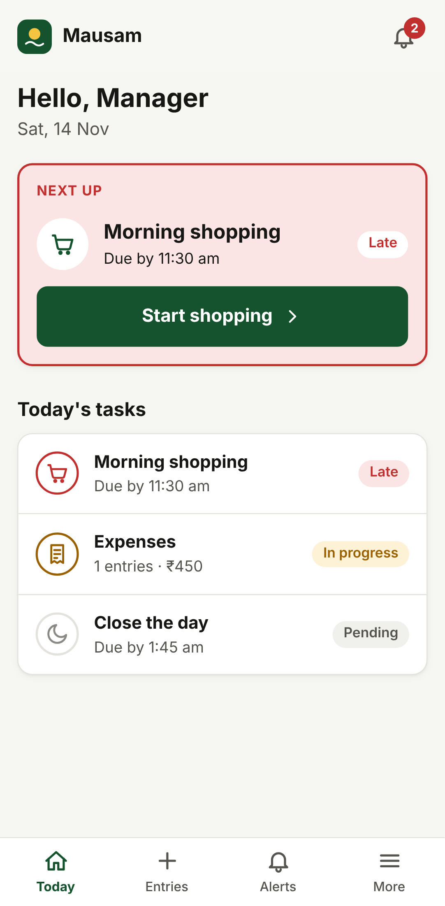
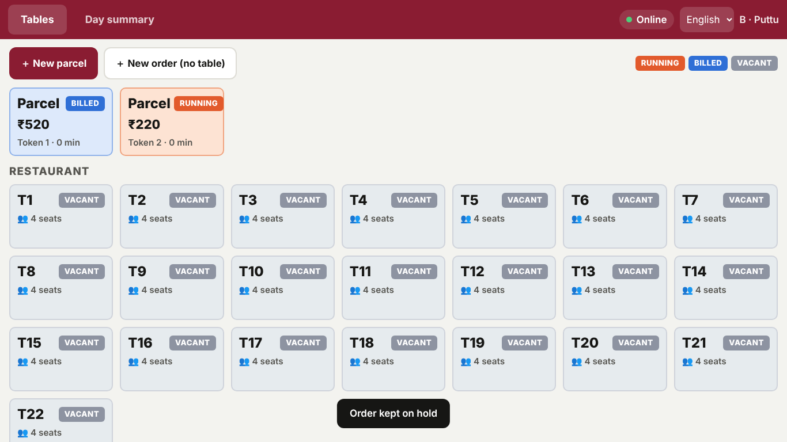
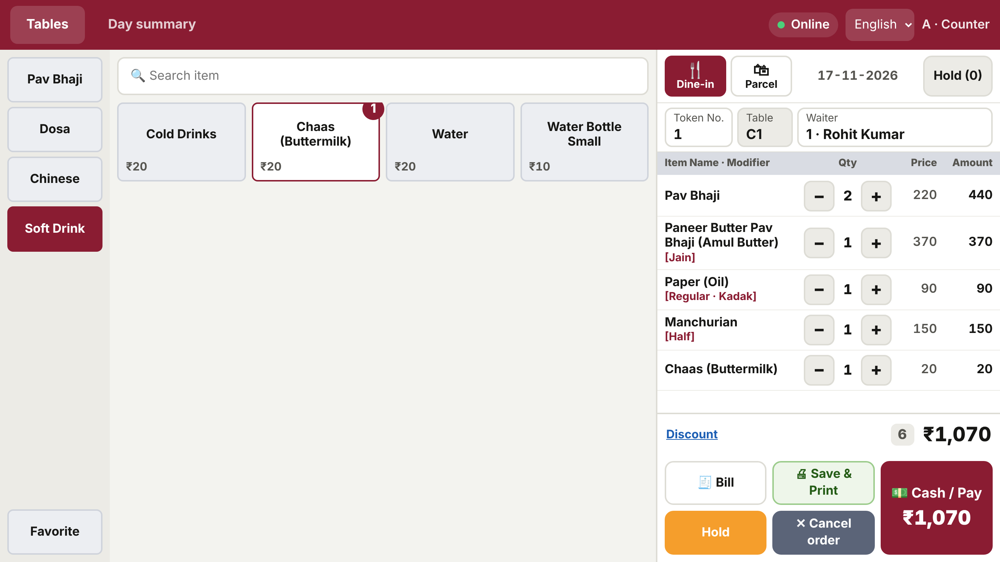

# How to use the admin app and the POS

A plain guide for the owner: getting the admin app set up, helping managers install it, and running the POS at the counter. For putting the app online in the first place, see [cloudflare-setup.md](cloudflare-setup.md).

## The big picture

Mausam is one website with two doors: the **admin app** for you and your managers on phones, and the **POS** for billing at the counter. Both live at the same web address that Cloudflare gave you when the app was put online (it looks like `https://mausam-admin.<something>.workers.dev`). Nothing is installed from an app store.

|  | Admin app | POS |
| --- | --- | --- |
| Address | `https://<your address>/` | `https://<your address>/pos/` |
| Who uses it | You (owner) and your managers | Whoever bills at the counter (employees, managers) |
| Device | Any phone, or a laptop | The counter touchscreen PC, plus an optional second tablet or touchscreen |
| What it is for | Shopping, expenses, closing the day, attendance, vendors, reports, pay, settings | Taking orders, printing bills, taking payment |
| Login | Phone number + 4-digit PIN | The same phone number + PIN |

Everyone logs in with their own phone number and PIN, and what they see depends on their role:

- **Owner (you):** everything, including reports, pay, month close and all settings.
- **Manager:** daily entries (shopping, expenses, closing the day), attendance and advances, vendors, alerts, bills, and the basic reports (sales, cash and online, expenses). The deeper analytics only when you share them for the month.
- **Employee:** the POS only. If an employee opens the admin app, it sends them to the POS.

The two halves talk to each other. Every bill made on the POS flows into the admin app, so the day's sales, the closing check, best sellers and waiter commission fill in by themselves.

If you don't know your address yet, open the Cloudflare dashboard, go to **Workers & Pages → mausam-admin**, and copy the address shown there.

## Admin app: first-time setup (you, once, about 20 minutes)

Do these in order on your own phone or a laptop. You need the setup code you saved as `SETUP_CODE` in Cloudflare.

1. **Create your owner account.** Open `https://<your address>/`. The first screen asks for your name, phone number, a 4-digit PIN and the setup code. Fill them in and tap to create the account. You land on your **Today** screen. This screen appears only once; after that, everyone sees the normal login.
2. **Install it on your phone.** In Chrome, tap **⋮ → Add to Home screen** (iPhone: Safari, **Share → Add to Home Screen**). From now on, open Mausam from that icon like any app.
3. **Turn on reminders.** **More → Turn on reminders**, allow notifications, then tap **Send a test**.
4. **Add your people who log in.** **More → Manage → App users.** Add each manager and each counter person with their phone number, a 4-digit PIN, their language (English, Hindi or Kannada) and their role (Manager or Employee). Tell each person their PIN yourself.
5. **Add your staff list.** **Manage → Staff.** Everyone on the payroll, including people who never log in (cooks, cleaners). Leave pay blank if you don't know it yet. This list is what attendance and month-end pay use.
6. **Add waiters.** **Manage → Waiters.** Each waiter gets an ID number and a commission %. The POS asks for a waiter on every table order, so do this before the first service.
7. **Check the menu.** **Manage → Menu.** Mausam's printed menu is already loaded, with Hindi and Kannada names, variations (Regular/Jain, Kadak/Medium/Naram, Full/Half) and favourites. Fix any price that is wrong.
8. **Check the tables.** **Manage → Tables.** T1 to T22 are already there. Rename, add or remove tables to match your floor.
9. **Set POS options.** **Manage → POS options.** The bill heading (name, address, phone), the footer, whether a receipt printer is connected, how many copies of each bill print (2 by default, one for the kitchen), whether to show the table map, and GST if you charge it.
10. **Set reminders and categories.** **Manage → Reminders and rules** picks who gets each reminder and at what time (for example, shopping to the head manager, closing to the assistant manager). **Manage → Categories** holds the expense categories.

Once steps 1 to 9 are done, the counter can start billing. Reminders and categories can be tuned later.

## Admin app: how you use it as owner

Your managers do the data entry; your job is to look, check and decide. The bottom bar on the phone has **Today, Entries, Reports, More**. On a laptop the same pages are in the left menu.

**Every day (2 minutes)**

- **Today:** the day's sales, cash vs online, what was spent, and whether shopping and closing were done on time. Anything odd is flagged here.
- **The bell (Alerts):** you are told when a closing is missing by 10 am, shopping is still open at 1 pm, attendance wasn't marked, a closing memo doesn't add up, an expense is far above normal, or a vendor charged above the agreed rate.
- **Entries:** open any shopping, expense or closing to see the bill photos and the memo photo.

**How the money check works.** Cash left in the drawer + online + expenses paid from the counter must equal the counter total. The app checks this on every closing. A business day runs 5 am to 5 am, so a 1:30 am closing counts for the day before. A day locks at 11 am the next morning; after that only you can change it, and every change is recorded in **Manage → Change history**.

**Every week or so**

- **Reports:** sales trend and busy hours, sales by weekday, expenses by category, cash vs online, on-time reporting, costs and profit (food cost %, wages %), best sellers, price watch, and **Waiters** (bills, sales and commission per waiter).
- **Vendors:** what you owe each supplier, deliveries and payments.
- **POS bills:** every bill from the counter, including cancelled ones and their reasons.

**At month end (27th to 3rd)**

- **More → People → Month-end pay:** days worked, advances, waiter commission and adjustments for each person; mark each as paid.
- **More → Month close:** a checklist, monthly bills, a tally comparison, print, then lock. A closed month is locked for everyone until you reopen it.

**Sharing analytics with managers.** Managers always see bills, sales, cash and online, and expenses. In **Reports**, **Share with managers this month** also lets them see the deeper analytics until the end of the month; it switches off by itself on the 1st.

## Helping your managers install it (5 minutes per phone)

There is nothing to download from the Play Store. You send a link, and the manager adds it to their home screen. Do this sitting next to them the first time.

**Before you start:** add them in **Manage → App users** with their phone number, a PIN, their language and the role **Manager**.

**On an Android phone**

1. Send them your address on WhatsApp: `https://<your address>/`. Ask them to open it in **Chrome** (not inside WhatsApp: tap **⋮ → Open in Chrome**).
2. They log in with their phone number and PIN. The language buttons are on the login screen.
3. Tap **⋮** (top right) → **Add to Home screen** → **Add**. A Mausam icon appears on the home screen. From now on they open it from there.
4. Open the app from the icon, go to **More → Turn on reminders**, tap **Allow**, then **Send a test**. A notification should pop up.
5. On Xiaomi, Redmi, Oppo, Vivo and Realme phones, also open the phone's **Settings → Battery → Chrome → No restrictions**. Without it, reminders arrive late.

**On an iPhone** (iOS 16.4 or newer): open the link in **Safari**, log in, tap **Share → Add to Home Screen**, then open Mausam from the home-screen icon and turn on reminders there.

**What a manager does each day**

- **Morning:** **Entries → Shopping**: cash taken for the market, each bill with a photo, and the cash brought back.
- **During the day:** **Entries → Expenses → Add**: amount, category and a photo of the bill.
- **Attendance:** **More → People → Attendance** for present, half day, absent or leave, and advances paid from the counter.
- **Night:** **Entries → Close the day**: photo of the handwritten memo, cash in the drawer, online total. The POS total is filled in already. The app reads the memo photo and warns if the numbers don't add up.

The **Today** screen always shows the next task, so a manager doesn't need to remember this list. If they have no internet, entries wait on the phone and send when it's back.



**If a manager forgets their PIN** or leaves the job: **Manage → App users**, change the PIN or switch the user off. Five wrong PINs lock an account for 15 minutes.

## POS: which devices, where, and the one-time setup

The POS is a web page made for a touchscreen, with big buttons and on-screen number pads, so no keyboard or mouse is needed. It needs Chrome and the internet once to log in; after that it keeps billing even if the internet drops.

**Where it runs**

| Device | Where | Use it for |
| --- | --- | --- |
| Counter PC (the Posiflex Windows touchscreen) with the Rugtek 80 mm receipt printer | The billing counter | Main POS: every order, printing bills and the kitchen copy, payment, day summary. Counter letter **A**. |
| A second touchscreen or Android tablet (optional) | Near the floor or the parcel window | Taking orders and payment at the same time as the counter. Counter letter **B**. |

Both devices open the same address and share everything: an order started on one shows on the other within a few seconds, token numbers are shared, and the day summary shows both devices' bills. A phone works too in a pinch, but the screen is small.

Printing is set up on the counter PC. A second device without its own printer is best used for taking orders: the order appears on the counter PC, and the bill is printed there.

**One-time setup on the counter PC (about 15 minutes)**

1. Do the admin app setup above first (menu, tables, waiters, an **Employee** login for each counter person, POS options).
2. **Printer:** plug the Rugtek in by USB, install its driver (80 mm model), make it the Windows **default printer**, and set the paper to **80 mm receipt**.
3. **Chrome print settings, once:** open `https://<your address>/pos/` in Chrome, log in, open any bill and press **Ctrl+P**. Choose the Rugtek, **Margins: None**, **Headers and footers: off**, then **Print**. Chrome remembers this.
4. **A desktop shortcut that prints without a pop-up:** right-click the desktop → **New → Shortcut**, paste the line below, and name it **Mausam POS**. Always open the POS from this shortcut. It opens full screen; **Alt+F4** closes it.
   ```
   "C:\Program Files\Google\Chrome\Application\chrome.exe" --kiosk --kiosk-printing https://<your address>/pos/
   ```
5. **Optional, start it with the PC:** press **Win+R**, type `shell:startup`, and copy the shortcut into that folder.
6. **First login:** log in with a counter person's phone number and PIN, then pick counter letter **A**. Bill numbers then start with A (for example A2627-00042).

**Second device:** open `https://<your address>/pos/` in Chrome, log in, and pick counter letter **B**. On an Android tablet, **⋮ → Add to Home screen** gives it an icon.

The full printer steps and printer troubleshooting are in [pos-printing.md](pos-printing.md).

## POS: everyday use at the counter

The POS works like the counter's old POS. The home screen is **Tables**: a tile for each table, coloured **Vacant** (grey), **Running** (orange, order being taken) or **Billed** (blue, bill printed, waiting for payment), plus buttons for **New parcel** and **New order (no table)**.



**A table order**

1. Tap the table (for example T5). Pick the waiter serving it from the big buttons; payment can't be taken until a waiter is picked.
2. Tap a category on the left (Pav Bhaji, Dosa, Chinese, Soft Drink, Favorite) and tap items to add them. Use **+ / −** to change quantity. Items with choices (Regular/Jain, Kadak/Medium/Naram, Full/Half) ask for the choice. The search box finds any item by name.
3. Tap **Save & Print**. The order is saved and the bill prints twice: one copy for the kitchen, one for the guest's table. The table turns **Running**.
4. More items later: tap the table again, add them, and **Save & Print** again.
5. When the guest pays, tap **Cash / Pay**. Choose **Cash** (type the cash given and the screen shows the change to give back), **UPI**, **Card**, or split between them. Tap **Done, close bill**. The table goes back to **Vacant**.



**A parcel:** tap **New parcel**, add items, **Save & Print**, then **Cash / Pay**. Parcels get a token number and don't need a waiter.

**Other buttons on the order screen**

- **Bill:** shows or reprints the bill (marked "Duplicate").
- **Hold:** parks an order and goes back to Tables; **Hold (n)** at the top brings it back.
- **Discount:** an amount in ₹ or a percent off.
- **Cancel order:** asks for a reason (guest left, wrong order, test bill, other). Cancelled orders show in the admin app under **POS bills**.

**End of the day:** open **Day summary** (top left). It shows the day's sales by payment mode (cash, UPI, card) and by waiter, and any bills **Not sent yet**. Check it says **All bills sent**, then the manager uses these numbers for **Close the day** in the admin app (the POS total is filled in by itself).

**If the internet drops:** keep billing. The top bar says **Offline: bills are saved here**, bills keep their numbers, and everything is sent when the internet is back. **Day summary → Send now** sends them straight away.

**Language:** the dropdown at the top switches the POS between English, Hindi and Kannada at any time; the menu items change language too.

## If something goes wrong

| What happens | What to do |
| --- | --- |
| Someone can't log in | Check the phone number. After 5 wrong PINs the account locks for 15 minutes. You can set a new PIN in **Manage → App users**. |
| An employee opens the admin app and lands on the POS | That's by design: employees only use the POS. Change their role to Manager if they need the app. |
| A manager's reminders don't come | Redo **More → Turn on reminders** on their phone, and the battery setting on Xiaomi, Oppo, Vivo and Realme phones. |
| A print pop-up appears at the counter | Chrome was opened some other way. Close every Chrome window and open the **Mausam POS** shortcut. |
| Nothing prints | Check paper and the printer light, print a Windows test page, and check **A receipt printer is connected** is on in **Manage → POS options**. |
| The printer is broken | Switch **A receipt printer is connected** off in **POS options**. Bills show on screen instead, and billing carries on. |
| The POS says Offline | Keep billing. Bills are sent when the internet is back. Check **Day summary** before closing for the night. |
| The POS says bills were refused by the server | Tell the owner and open **POS bills** in the admin app. |
| A wrong price on the POS | Fix it in **Manage → Menu**; the POS picks up the change the next time it loads. |
| An update to the app broke something | In Cloudflare, **mausam-admin → Deployments**, pick the version before it and choose **Rollback**. |

**Quick reference**

- Admin app: `https://<your address>/` (phones, home-screen icon)
- POS: `https://<your address>/pos/` (counter PC via the **Mausam POS** shortcut)
- Setup details: [cloudflare-setup.md](cloudflare-setup.md) and [pos-printing.md](pos-printing.md)
